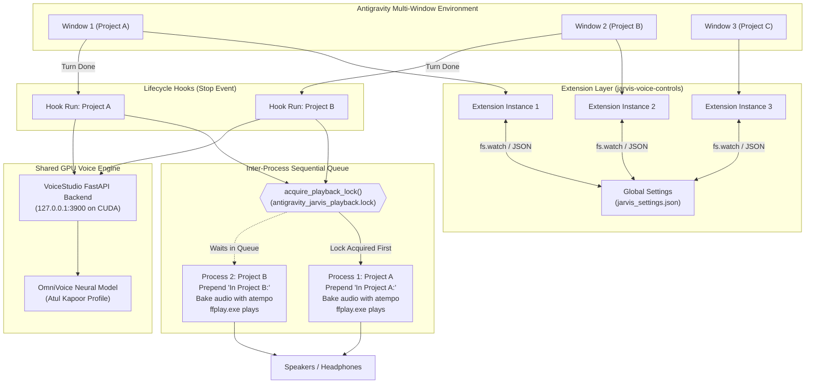

# J.A.R.V.I.S. Offline Voice Pipeline for Google Antigravity IDE
**Complete Architecture, Implementation, and Multi-Window Developer Reference**

> [!NOTE]
> This document provides an exhaustive record of the offline voice pipeline built for Google Antigravity IDE, replacing cloud subscriptions (Wispr Flow and ElevenLabs) with 100% private, locally accelerated AI models running on an NVIDIA GeForce RTX 4070 GPU. It includes multi-window sequential queue coordination, project announcement prefixes, live global controls, conversation turn browsing, and arbitrary text-to-speech selection.

---

## 1. Executive Summary & Core Requirements

### 1.1 Offline Dictation (Wispr Flow Alternative)
* **Goal:** Zero cloud dependencies, zero monthly fees, private speech-to-text dictation.
* **Engine:** **Handy** (`cjpais/Handy`) using NVIDIA's **Parakeet TDT 0.6B** English model running locally via ONNX/CUDA runtime.
* **Experience:** Fast dictation into any Antigravity IDE prompt box or editor window via global push-to-talk.

### 1.2 Offline Speech Synthesis (ElevenLabs Alternative)
* **Goal:** High-fidelity neural voice cloning running locally on an NVIDIA RTX 4070 GPU.
* **Engine:** **VoiceStudio** (`debpalash/VoiceStudio`), running `k2-fsa/OmniVoice` on CUDA.
* **VRAM Efficiency:** Operates as a single headless Python FastAPI backend on port 3900 shared across all Antigravity windows (~4.7 GB VRAM footprint).

### 1.3 The Authentic Voice of J.A.R.V.I.S. (Atul Kapoor)
* **Voice Actor:** **Atul Kapoor** (the official Indian voice actor for Marvel's J.A.R.V.I.S. in *Iron Man* & *The Avengers*, and the voice of *Bigg Boss*).
* **Reference Audio:** Sourced from high-fidelity 48kHz studio recordings, isolated with VoiceStudio to produce speaker profile `f3734950`.
* **Timbre Preservation:** The neural synthesis model runs strictly at native `speed: 1.0` to preserve his commanding baritone resonance, with post-synthesis time-stretching handled via FFmpeg `atempo`.

### 1.4 Multi-Window & Multi-Project Coordination
* **Sequential Playback Queue:** When multiple Antigravity IDE windows/projects finish generating turns around the same time, speech announcements are queued sequentially using an atomic Win32 inter-process lock (`antigravity_jarvis_playback.lock`) with active PID verification (`OpenProcess`). Processes wait their turn and play in sequence without garbling or clipping each other.
* **Project Announcement Prefix:** Turns are dynamically prefixed with the project or workspace title (e.g. *"In Handy App Installation Guide: ..."* or *"In Attendance: ..."*), resolved from Antigravity's conversation SQLite database (`conversation_summaries.db`).
* **Live Global Synchronization:** Status bar speed (`1.0x` - `2.0x`) and mute toggle (`JARVIS: ON / OFF`) are monitored via `fs.watch` and synchronize live across all open windows in real-time.
* **Workspace Isolation for Replay & History:** The status bar Replay button, Conversation History picker (`Alt + H`), and `--read-turn` inspect the current window's active workspace folder (`vscode.workspace.workspaceFolders`), keeping conversational transcripts strictly isolated per project.
* **Speak Highlighted Selection (`Alt + S`):** Highlight any code comment, diff, or summary in the editor and press `Alt + S` or right-click to hear it read aloud immediately.

---

## 2. System Architecture & Component Interaction



---

## 3. Directory Layout

```text
C:\Users\Admin\
├── .gemini\
│   └── config\
│       ├── jarvis_settings.json               # Live global settings (enabled, speed, voice)
│       ├── scripts\
│       │   └── jarvis_speech.py               # Core TTS queue, cleaner & playback bridge
│       └── plugins\
│           └── jarvis-voice\                  # Native Antigravity Plugin
│               ├── plugin.json                # Plugin manifest
│               └── hooks.json                 # Lifecycle hook definition (Stop event)
├── .antigravity-ide\
│   └── extensions\
│       └── jarvis-voice-controls\             # IDE Extension (Status bar UI & controls)
│           ├── package.json                   # Commands, keybindings & menus
│           └── extension.js                   # Window-scoped runner & settings watcher
└── D:\VoiceStudio\
    ├── data\                                 # Profile DB & voice embeddings
    │   └── omnivoice.db                       # Contains Atul Kapoor profile f3734950
    └── project\
        ├── .venv\Scripts\python.exe           # PyTorch + CUDA virtualenv
        └── backend\main.py                    # FastAPI server entry point
```

---

## 4. Complete Code Listings

### File 1: `jarvis_settings.json`
*Path:* `C:\Users\Admin\.gemini\config\jarvis_settings.json`

```json
{
  "enabled": true,
  "speed": 1.2,
  "voice": "Atul Kapoor"
}
```

---

### File 2: `hooks.json`
*Path:* `C:\Users\Admin\.gemini\config\plugins\jarvis-voice\hooks.json`

```json
{
  "jarvis-voice": {
    "enabled": true,
    "Stop": [
      {
        "type": "command",
        "command": "python C:/Users/Admin/.gemini/config/scripts/jarvis_speech.py",
        "timeout": 600
      }
    ]
  }
}
```

---

### File 3: `package.json`
*Path:* `C:\Users\Admin\.antigravity-ide\extensions\jarvis-voice-controls\package.json`

```json
{
  "name": "jarvis-voice-controls",
  "displayName": "J.A.R.V.I.S. Voice Controls",
  "description": "Status bar & context menu controls for J.A.R.V.I.S. voice synthesis (Mute/Unmute, Stop, Speed, Replay, History, Speak Selection)",
  "version": "1.1.0",
  "publisher": "antigravity-user",
  "engines": {
    "vscode": "^1.80.0"
  },
  "categories": [
    "Other"
  ],
  "activationEvents": [
    "*"
  ],
  "main": "./extension.js",
  "contributes": {
    "commands": [
      {
        "command": "jarvis.toggleMute",
        "title": "J.A.R.V.I.S.: Toggle Mute / Unmute"
      },
      {
        "command": "jarvis.stopAudio",
        "title": "J.A.R.V.I.S.: Stop Speech Now"
      },
      {
        "command": "jarvis.changeSpeed",
        "title": "J.A.R.V.I.S.: Change Playback Speed"
      },
      {
        "command": "jarvis.replayAudio",
        "title": "J.A.R.V.I.S.: Replay Last Message"
      },
      {
        "command": "jarvis.showHistory",
        "title": "J.A.R.V.I.S.: Browse & Read Conversation History"
      },
      {
        "command": "jarvis.speakSelection",
        "title": "J.A.R.V.I.S.: Speak Selected Text"
      }
    ],
    "keybindings": [
      {
        "command": "jarvis.speakSelection",
        "key": "alt+s",
        "mac": "alt+s",
        "when": "editorHasSelection"
      },
      {
        "command": "jarvis.showHistory",
        "key": "alt+h",
        "mac": "alt+h"
      }
    ],
    "menus": {
      "editor/context": [
        {
          "command": "jarvis.speakSelection",
          "when": "editorHasSelection",
          "group": "navigation@100"
        }
      ]
    }
  }
}
```

---

### File 4: `extension.js`
*Path:* `C:\Users\Admin\.antigravity-ide\extensions\jarvis-voice-controls\extension.js`

```javascript
const vscode = require('vscode');
const fs = require('fs');
const path = require('path');
const os = require('os');
const http = require('http');
const { spawn, exec } = require('child_process');

const SETTINGS_FILE = 'C:\\Users\\Admin\\.gemini\\config\\jarvis_settings.json';
const SCRIPT_PATH = 'C:\\Users\\Admin\\.gemini\\config\\scripts\\jarvis_speech.py';
const PYTHON_PATH = 'D:\\VoiceStudio\\project\\.venv\\Scripts\\python.exe';
const PROJECT_DIR = 'D:\\VoiceStudio\\project';
const VOICESTUDIO_DATA_DIR = 'D:\\VoiceStudio\\data';
const VOICESTUDIO_MODELS_DIR = 'D:\\VoiceStudio\\models';
const LOCK_FILE = path.join(os.tmpdir(), 'antigravity_jarvis_playback.lock');

function readSettings() {
    const defaults = { enabled: true, speed: 1.2, voice: 'Atul Kapoor' };
    if (fs.existsSync(SETTINGS_FILE)) {
        try {
            const raw = fs.readFileSync(SETTINGS_FILE, 'utf8');
            return Object.assign(defaults, JSON.parse(raw));
        } catch (e) {
            console.error('Error reading jarvis_settings.json:', e);
        }
    }
    return defaults;
}

function writeSettings(settings) {
    try {
        const dir = path.dirname(SETTINGS_FILE);
        if (!fs.existsSync(dir)) {
            fs.mkdirSync(dir, { recursive: true });
        }
        fs.writeFileSync(SETTINGS_FILE, JSON.stringify(settings, null, 2), 'utf8');
    } catch (e) {
        console.error('Error writing jarvis_settings.json:', e);
    }
}

function checkBackendHealth() {
    return new Promise((resolve) => {
        const req = http.get('http://127.0.0.1:3900/health', { timeout: 1500 }, (res) => {
            resolve(res.statusCode === 200);
        });
        req.on('error', () => resolve(false));
        req.on('timeout', () => { req.destroy(); resolve(false); });
    });
}

function ensureHeadlessBackend(statusBarItem) {
    checkBackendHealth().then((isHealthy) => {
        if (isHealthy) {
            return;
        }

        if (!fs.existsSync(PYTHON_PATH)) {
            vscode.window.showWarningMessage('VoiceStudio Python environment not found on D: drive.');
            return;
        }

        if (statusBarItem) {
            statusBarItem.text = '$(sync~spin) JARVIS: Starting...';
        }

        const child = spawn(
            PYTHON_PATH,
            ['-m', 'uvicorn', 'main:app', '--app-dir', 'backend', '--host', '127.0.0.1', '--port', '3900'],
            {
                cwd: PROJECT_DIR,
                detached: true,
                stdio: 'ignore',
                windowsHide: true,
                env: Object.assign({}, process.env, {
                    OMNIVOICE_DATA_DIR: VOICESTUDIO_DATA_DIR,
                    OMNIVOICE_CACHE_DIR: VOICESTUDIO_MODELS_DIR
                })
            }
        );
        child.unref();

        let attempts = 0;
        const interval = setInterval(async () => {
            attempts++;
            const healthy = await checkBackendHealth();
            if (healthy) {
                clearInterval(interval);
                vscode.window.setStatusBarMessage('$(check) J.A.R.V.I.S. voice engine ready (headless)', 3500);
                if (statusBarItem) {
                    const settings = readSettings();
                    statusBarItem.text = settings.enabled ? '$(unmute) JARVIS: ON' : '$(mute) JARVIS: OFF';
                }
            } else if (attempts > 30) {
                clearInterval(interval);
                if (statusBarItem) {
                    statusBarItem.text = '$(error) JARVIS: Error';
                }
            }
        }, 1000);
    });
}

function getCurrentWorkspacePath() {
    if (vscode.workspace.workspaceFolders && vscode.workspace.workspaceFolders.length > 0) {
        return vscode.workspace.workspaceFolders[0].uri.fsPath;
    }
    return '';
}

function activate(context) {
    let settings = readSettings();

    // 1. Mute / Unmute Item
    const muteItem = vscode.window.createStatusBarItem(vscode.StatusBarAlignment.Right, 104);
    muteItem.command = 'jarvis.toggleMute';

    // 2. Stop Button
    const stopItem = vscode.window.createStatusBarItem(vscode.StatusBarAlignment.Right, 103);
    stopItem.command = 'jarvis.stopAudio';
    stopItem.text = '$(debug-stop) Stop';
    stopItem.tooltip = 'Click to silence J.A.R.V.I.S. speech immediately';

    // 3. Speed Selector
    const speedItem = vscode.window.createStatusBarItem(vscode.StatusBarAlignment.Right, 102);
    speedItem.command = 'jarvis.changeSpeed';

    // 4. Replay Button
    const replayItem = vscode.window.createStatusBarItem(vscode.StatusBarAlignment.Right, 101);
    replayItem.command = 'jarvis.replayAudio';
    replayItem.text = '$(history) Replay';
    replayItem.tooltip = 'Click to replay the last assistant message in Atul Kapoor voice';

    // 5. History Browser Button
    const historyItem = vscode.window.createStatusBarItem(vscode.StatusBarAlignment.Right, 100);
    historyItem.command = 'jarvis.showHistory';
    historyItem.text = '$(list-unordered) History';
    historyItem.tooltip = 'Browse and speak past conversation turns for this window (Alt+H)';

    function updateUI() {
        settings = readSettings();
        if (settings.enabled) {
            muteItem.text = '$(unmute) JARVIS: ON';
            muteItem.tooltip = 'J.A.R.V.I.S. voice is active globally. Click to MUTE.';
            muteItem.backgroundColor = undefined;
        } else {
            muteItem.text = '$(mute) JARVIS: OFF';
            muteItem.tooltip = 'J.A.R.V.I.S. voice is MUTED globally. Click to UNMUTE.';
            muteItem.backgroundColor = new vscode.ThemeColor('statusBarItem.warningBackground');
        }
        const speedVal = Number(settings.speed);
        speedItem.text = `$(dashboard) ${speedVal.toFixed(speedVal % 1 === 0 ? 1 : 2)}x`;
        speedItem.tooltip = `Current global speed is ${speedVal}x. Click to change.`;
    }

    updateUI();
    muteItem.show();
    stopItem.show();
    speedItem.show();
    replayItem.show();
    historyItem.show();

    ensureHeadlessBackend(muteItem);

    // Synchronize settings live across all open windows
    if (fs.existsSync(SETTINGS_FILE)) {
        fs.watch(SETTINGS_FILE, () => {
            updateUI();
        });
    }

    // Command: Toggle Mute (Global)
    const toggleMuteCmd = vscode.commands.registerCommand('jarvis.toggleMute', () => {
        settings = readSettings();
        settings.enabled = !settings.enabled;
        writeSettings(settings);
        updateUI();

        if (!settings.enabled) {
            exec('taskkill /F /IM ffplay.exe', () => {});
            try { if (fs.existsSync(LOCK_FILE)) fs.unlinkSync(LOCK_FILE); } catch (e) {}
            vscode.window.showInformationMessage('J.A.R.V.I.S. voice is now MUTED across all windows');
        } else {
            vscode.window.showInformationMessage('J.A.R.V.I.S. voice is now ON');
        }
    });

    // Command: Stop Audio (Global)
    const stopAudioCmd = vscode.commands.registerCommand('jarvis.stopAudio', () => {
        exec('taskkill /F /IM ffplay.exe', (err) => {
            try { if (fs.existsSync(LOCK_FILE)) fs.unlinkSync(LOCK_FILE); } catch (e) {}
            if (!err) {
                vscode.window.setStatusBarMessage('$(check) J.A.R.V.I.S. stopped', 2500);
            }
        });
    });

    // Command: Change Speed (Global)
    const changeSpeedCmd = vscode.commands.registerCommand('jarvis.changeSpeed', async () => {
        const options = [
            { label: '1.0x', description: 'Original natural speed', value: 1.0 },
            { label: '1.2x', description: 'Comfortable relaxed pace (Recommended)', value: 1.2 },
            { label: '1.35x', description: 'Brisk & productive', value: 1.35 },
            { label: '1.5x', description: 'Fast pace', value: 1.5 },
            { label: '1.75x', description: 'Very fast pace', value: 1.75 },
            { label: '2.0x', description: 'Double speed', value: 2.0 }
        ];

        const selected = await vscode.window.showQuickPick(options, {
            placeHolder: `Select J.A.R.V.I.S. voice playback speed across all windows (current: ${settings.speed}x)`
        });

        if (selected) {
            settings = readSettings();
            settings.speed = selected.value;
            writeSettings(settings);
            updateUI();
            vscode.window.showInformationMessage(`J.A.R.V.I.S. speed set to ${selected.value}x across all windows`);
        }
    });

    // Command: Replay Last (Scoped to current workspace)
    const replayCmd = vscode.commands.registerCommand('jarvis.replayAudio', () => {
        const ws = getCurrentWorkspacePath();
        const wsArg = ws ? ` --workspace "${ws}"` : '';
        vscode.window.setStatusBarMessage('$(history) Replaying last message...', 3000);
        exec(`python "${SCRIPT_PATH}" --replay${wsArg}`, (err) => {
            if (err) {
                vscode.window.showErrorMessage('Error replaying audio: ' + err.message);
            }
        });
    });

    // Command: Browse Conversation History (Scoped to current workspace)
    const showHistoryCmd = vscode.commands.registerCommand('jarvis.showHistory', () => {
        const ws = getCurrentWorkspacePath();
        const wsArg = ws ? ` --workspace "${ws}"` : '';
        vscode.window.setStatusBarMessage('$(sync~spin) Loading conversation turns...', 2000);
        exec(`python "${SCRIPT_PATH}" --get-history${wsArg}`, { maxBuffer: 10 * 1024 * 1024 }, async (err, stdout) => {
            if (err || !stdout) {
                vscode.window.showErrorMessage('Could not retrieve conversation history for this workspace.');
                return;
            }
            try {
                const turns = JSON.parse(stdout);
                if (!turns.length) {
                    vscode.window.showInformationMessage('No conversation messages found in current transcript.');
                    return;
                }
                const reversed = turns.slice().reverse();
                const quickPickItems = reversed.map(t => ({
                    label: `${t.role === 'You' ? '$(person)' : '$(robot)'} #${t.id} ${t.role}`,
                    description: t.summary,
                    turnId: t.id
                }));

                const picked = await vscode.window.showQuickPick(quickPickItems, {
                    placeHolder: 'Select a message to speak aloud with Atul Kapoor voice...'
                });

                if (picked) {
                    vscode.window.setStatusBarMessage(`$(unmute) J.A.R.V.I.S.: Speaking turn #${picked.turnId}...`, 4000);
                    exec(`python "${SCRIPT_PATH}" --read-turn ${picked.turnId}${wsArg}`, (playErr) => {
                        if (playErr) {
                            vscode.window.showErrorMessage('Playback error: ' + playErr.message);
                        }
                    });
                }
            } catch (e) {
                vscode.window.showErrorMessage('Error parsing conversation history: ' + e.message);
            }
        });
    });

    // Command: Speak Selected Text (Option C)
    const speakSelectionCmd = vscode.commands.registerCommand('jarvis.speakSelection', () => {
        const editor = vscode.window.activeTextEditor;
        if (!editor) {
            vscode.window.showWarningMessage('No active editor found to read from.');
            return;
        }

        const selection = editor.selection;
        const text = editor.document.getText(selection);

        if (!text || !text.trim()) {
            vscode.window.showWarningMessage('Please highlight/select some text first to speak.');
            return;
        }

        const tempFile = path.join(os.tmpdir(), 'jarvis_speak_selection.txt');
        try {
            fs.writeFileSync(tempFile, text, 'utf8');
        } catch (e) {
            vscode.window.showErrorMessage('Failed to write temporary text file: ' + e.message);
            return;
        }

        vscode.window.setStatusBarMessage('$(unmute) J.A.R.V.I.S.: Synthesizing selected text...', 3500);
        exec(`python "${SCRIPT_PATH}" --speak-file "${tempFile}"`, (err) => {
            if (err) {
                vscode.window.showErrorMessage('Error speaking selection: ' + err.message);
            }
        });
    });

    // Command: Start Backend Manually
    const startBackendCmd = vscode.commands.registerCommand('jarvis.startBackend', () => {
        ensureHeadlessBackend(muteItem);
    });

    context.subscriptions.push(
        muteItem,
        stopItem,
        speedItem,
        replayItem,
        historyItem,
        toggleMuteCmd,
        stopAudioCmd,
        changeSpeedCmd,
        replayCmd,
        showHistoryCmd,
        speakSelectionCmd,
        startBackendCmd
    );
}

function deactivate() {
    exec('taskkill /F /IM ffplay.exe', () => {});
    try { if (fs.existsSync(LOCK_FILE)) fs.unlinkSync(LOCK_FILE); } catch (e) {}
}

module.exports = {
    activate,
    deactivate
};
```

---

### File 5: `jarvis_speech.py`
*Path:* `C:\Users\Admin\.gemini\config\scripts\jarvis_speech.py`

```python
import sys
import os
import json
import re
import hashlib
import urllib.request
import urllib.error
import urllib.parse
import subprocess
import tempfile
import time
import glob
import sqlite3
import ctypes

SETTINGS_FILE = r"C:\Users\Admin\.gemini\config\jarvis_settings.json"
CONVERSATION_DB_PATH = r"C:\Users\Admin\.gemini\antigravity\conversation_summaries.db"
BRAIN_DIR = r"C:\Users\Admin\.gemini\antigravity\brain"

TEMP_DIR = tempfile.gettempdir()
LOG_FILE = os.path.join(TEMP_DIR, "antigravity_jarvis.log")
LOCK_FILE = os.path.join(TEMP_DIR, "antigravity_jarvis_playback.lock")
GLOBAL_RAW_AUDIO_PATH = os.path.join(TEMP_DIR, "antigravity_jarvis_raw.mp3")
GLOBAL_READY_AUDIO_PATH = os.path.join(TEMP_DIR, "antigravity_jarvis_ready.wav")
TRANSCRIPT_TRACK_FILE = os.path.join(TEMP_DIR, "antigravity_jarvis_last_transcript.txt")
WORKSPACE_MAP_FILE = os.path.join(TEMP_DIR, "antigravity_jarvis_workspace_map.json")

PYTHON_BACKEND_PATH = r"D:\VoiceStudio\project\.venv\Scripts\python.exe"
PROJECT_DIR = r"D:\VoiceStudio\project"
VOICESTUDIO_DATA_DIR = r"D:\VoiceStudio\data"
VOICESTUDIO_MODELS_DIR = r"D:\VoiceStudio\models"
FFMPEG_PATH = r"C:\ffmpeg\bin\ffmpeg.exe"
FFPLAY_PATH = r"C:\ffmpeg\bin\ffplay.exe"

def load_settings():
    defaults = {"enabled": True, "speed": 1.2, "voice": "Atul Kapoor"}
    if os.path.exists(SETTINGS_FILE):
        try:
            with open(SETTINGS_FILE, "r", encoding="utf-8") as f:
                data = json.load(f)
                defaults.update(data)
        except Exception:
            pass
    return defaults

def log(msg):
    try:
        with open(LOG_FILE, "a", encoding="utf-8") as f:
            f.write(f"[{time.strftime('%Y-%m-%d %H:%M:%S')}] {msg}\n")
    except Exception:
        pass

def is_pid_alive(pid):
    """Check whether a process ID is currently running on Windows."""
    if pid <= 0:
        return False
    try:
        PROCESS_QUERY_LIMITED_INFORMATION = 0x1000
        handle = ctypes.windll.kernel32.OpenProcess(PROCESS_QUERY_LIMITED_INFORMATION, False, pid)
        if handle:
            ctypes.windll.kernel32.CloseHandle(handle)
            return True
        return False
    except Exception:
        return False

def acquire_playback_lock(timeout=180):
    """Sequential queue: acquire an exclusive inter-process lock for audio playback."""
    start_time = time.time()
    while time.time() - start_time < timeout:
        try:
            fd = os.open(LOCK_FILE, os.O_CREAT | os.O_EXCL | os.O_RDWR)
            try:
                os.write(fd, str(os.getpid()).encode())
            except Exception:
                pass
            return fd
        except FileExistsError:
            # Check for stale lock
            try:
                if os.path.exists(LOCK_FILE):
                    # If lock file exists, check if owning PID is alive
                    try:
                        with open(LOCK_FILE, "r") as f:
                            raw_pid = f.read().strip()
                        if raw_pid.isdigit() and not is_pid_alive(int(raw_pid)):
                            os.remove(LOCK_FILE)
                            continue
                    except Exception:
                        pass
                    # If file is older than 2 minutes, clear it
                    if time.time() - os.path.getmtime(LOCK_FILE) > 120:
                        os.remove(LOCK_FILE)
                        continue
            except Exception:
                pass
            time.sleep(0.3)
    return None

def release_playback_lock(fd):
    """Release playback lock and clean up lock file."""
    try:
        if fd is not None:
            os.close(fd)
        if os.path.exists(LOCK_FILE):
            os.remove(LOCK_FILE)
    except Exception:
        pass

def extract_conv_id(transcript_path):
    if not transcript_path:
        return "default"
    norm = os.path.normpath(transcript_path)
    parts = norm.split(os.sep)
    if "brain" in parts:
        idx = parts.index("brain")
        if idx + 1 < len(parts):
            return parts[idx + 1]
    return hashlib.md5(transcript_path.encode()).hexdigest()[:12]

def get_workspace_name_for_conv(conv_id):
    """Query Antigravity conversation database to get human-readable project title."""
    if not os.path.exists(CONVERSATION_DB_PATH) or not conv_id:
        return None
    try:
        conn = sqlite3.connect(CONVERSATION_DB_PATH)
        cur = conn.cursor()
        cur.execute("SELECT workspace_uris, title FROM conversation_summaries WHERE conversation_id = ?", (conv_id,))
        row = cur.fetchone()
        conn.close()
        if row:
            uris_raw, title = row
            if uris_raw:
                try:
                    uris = json.loads(uris_raw)
                    if uris and isinstance(uris, list):
                        uri = uris[0]
                        parsed = urllib.parse.urlparse(uri)
                        unquoted = urllib.parse.unquote(parsed.path)
                        if unquoted.startswith('/') and len(unquoted) > 2 and unquoted[2] == ':':
                            unquoted = unquoted[1:]
                        ws_name = os.path.basename(os.path.normpath(unquoted))
                        if ws_name and ws_name.lower() not in ["scratch", "default", "none", "temp"]:
                            clean_ws = ws_name.replace('-', ' ').replace('_', ' ').strip()
                            return clean_ws
                except Exception:
                    pass
            if title and title.strip():
                # Clean up title for concise speech announcement
                clean_title = re.sub(r'[^a-zA-Z0-9 _-]', '', title.strip())
                clean_title = clean_title.replace('-', ' ').replace('_', ' ').strip()
                if len(clean_title) > 32:
                    words = clean_title[:32].rsplit(' ', 1)
                    clean_title = words[0] if len(words) > 1 else clean_title[:32]
                return clean_title
    except Exception as e:
        log(f"Error querying conversation DB for workspace name: {e}")
    return None

def get_conversation_for_workspace_path(ws_path):
    """Resolve workspace directory path to its latest Antigravity conversation transcript."""
    if not ws_path:
        return None
    norm_ws = os.path.normpath(ws_path).replace('\\', '/').lower()

    if os.path.exists(CONVERSATION_DB_PATH):
        try:
            conn = sqlite3.connect(CONVERSATION_DB_PATH)
            cur = conn.cursor()
            cur.execute("SELECT conversation_id, workspace_uris, last_modified_time FROM conversation_summaries ORDER BY last_modified_time DESC")
            rows = cur.fetchall()
            conn.close()
            for conv_id, uris_raw, _ in rows:
                if not uris_raw:
                    continue
                try:
                    uris = json.loads(uris_raw)
                    for u in uris:
                        parsed = urllib.parse.urlparse(u)
                        path = urllib.parse.unquote(parsed.path)
                        if path.startswith('/') and len(path) > 2 and path[2] == ':':
                            path = path[1:]
                        if os.path.normpath(path).replace('\\', '/').lower() == norm_ws:
                            t_path = os.path.join(BRAIN_DIR, conv_id, ".system_generated", "logs", "transcript.jsonl")
                            if os.path.exists(t_path):
                                return t_path
                except Exception:
                    pass
        except Exception as e:
            log(f"Error resolving conversation for workspace path: {e}")

    # Fallback: check workspace map file
    if os.path.exists(WORKSPACE_MAP_FILE):
        try:
            with open(WORKSPACE_MAP_FILE, "r", encoding="utf-8") as f:
                w_map = json.load(f)
            if norm_ws in w_map and os.path.exists(w_map[norm_ws]):
                return w_map[norm_ws]
        except Exception:
            pass
    return None

def record_workspace_mapping(conv_id, transcript_path):
    """Update workspace to transcript cache file."""
    if not conv_id or not transcript_path:
        return
    try:
        w_map = {}
        if os.path.exists(WORKSPACE_MAP_FILE):
            try:
                with open(WORKSPACE_MAP_FILE, "r", encoding="utf-8") as f:
                    w_map = json.load(f)
            except Exception:
                pass
        w_map[conv_id] = transcript_path

        if os.path.exists(CONVERSATION_DB_PATH):
            conn = sqlite3.connect(CONVERSATION_DB_PATH)
            cur = conn.cursor()
            cur.execute("SELECT workspace_uris FROM conversation_summaries WHERE conversation_id = ?", (conv_id,))
            row = cur.fetchone()
            conn.close()
            if row and row[0]:
                try:
                    uris = json.loads(row[0])
                    for u in uris:
                        parsed = urllib.parse.urlparse(u)
                        path = urllib.parse.unquote(parsed.path)
                        if path.startswith('/') and len(path) > 2 and path[2] == ':':
                            path = path[1:]
                        norm_p = os.path.normpath(path).replace('\\', '/').lower()
                        w_map[norm_p] = transcript_path
                except Exception:
                    pass

        with open(WORKSPACE_MAP_FILE, "w", encoding="utf-8") as f:
            json.dump(w_map, f, indent=2)
    except Exception as e:
        log(f"Error updating workspace mapping: {e}")

def ensure_backend_running():
    """Verify VoiceStudio backend is alive and has the Atul Kapoor voice profile loaded."""
    has_profile = False
    try:
        with urllib.request.urlopen("http://127.0.0.1:3900/profiles", timeout=1) as resp:
            profiles = json.loads(resp.read().decode("utf-8"))
            for p in profiles:
                if p.get("name") == "Atul Kapoor" or p.get("id") == "f3734950":
                    has_profile = True
                    break
        if has_profile:
            return True
        log("Backend running but lacks Atul Kapoor profile (wrong data dir). Restarting...")
        subprocess.run(["powershell", "-NoProfile", "-Command", "Get-NetTCPConnection -LocalPort 3900 -ErrorAction SilentlyContinue | ForEach-Object { Stop-Process -Id $_.OwningProcess -Force -ErrorAction SilentlyContinue }"], capture_output=True)
        time.sleep(1)
    except Exception:
        pass

    if os.path.exists(PYTHON_BACKEND_PATH):
        log("Starting headless VoiceStudio Python backend with OMNIVOICE_DATA_DIR...")
        ps_cmd = (
            f'$cmd = "cmd /c set OMNIVOICE_DATA_DIR={VOICESTUDIO_DATA_DIR}&& set OMNIVOICE_CACHE_DIR={VOICESTUDIO_MODELS_DIR}&& '
            f'{PYTHON_BACKEND_PATH} -m uvicorn main:app --app-dir backend --host 127.0.0.1 --port 3900"; '
            f'[wmiclass]"win32_process".Create($cmd, "{PROJECT_DIR}", $null)'
        )
        try:
            subprocess.run(["powershell", "-NoProfile", "-Command", ps_cmd], capture_output=True, check=False)
        except Exception as e:
            log(f"WMI process spawn failed: {e}")

        for _ in range(16):
            time.sleep(0.5)
            try:
                with urllib.request.urlopen("http://127.0.0.1:3900/profiles", timeout=1) as resp:
                    profiles = json.loads(resp.read().decode("utf-8"))
                    names = [p.get("name") for p in profiles]
                    log(f"Headless backend ready! Active profiles: {names}")
                    return True
            except Exception:
                pass
    return False

def clean_text_for_speech(text):
    if not text:
        return ""
    
    # Remove metadata & tags
    text = re.sub(r'<ADDITIONAL_METADATA>[\s\S]*?</ADDITIONAL_METADATA>', '', text)
    text = re.sub(r'</?USER_REQUEST>', '', text)
    # Remove code blocks
    text = re.sub(r'```[\s\S]*?```', '', text)
    # Remove HTML tags
    text = re.sub(r'<[^>]+>', '', text)
    # Remove markdown links, keep text label
    text = re.sub(r'\[([^\]]+)\]\([^\)]+\)', r'\1', text)
    # Remove images
    text = re.sub(r'!\[.*?\]\(.*?\)', '', text)
    # Remove tables (lines starting or ending with |)
    text = re.sub(r'^\s*\|.*\|.*$', '', text, flags=re.MULTILINE)
    # Remove header markings
    text = re.sub(r'^\s*#+\s*', '', text, flags=re.MULTILINE)
    # Remove blockquotes
    text = re.sub(r'^\s*>\s*', '', text, flags=re.MULTILINE)
    # Remove bold / italic
    text = re.sub(r'\*{1,3}(.*?)\*{1,3}', r'\1', text)
    text = re.sub(r'_{1,3}(.*?)_{1,3}', r'\1', text)
    # Remove inline backticks
    text = re.sub(r'`([^`]+)`', r'\1', text)
    # Remove bullet markers (- or * or numbered list)
    text = re.sub(r'^\s*[-*•]\s+', '', text, flags=re.MULTILINE)
    text = re.sub(r'^\s*\d+\.\s+', '', text, flags=re.MULTILINE)
    # Remove excessive horizontal rules
    text = re.sub(r'^\s*[-=_]{3,}\s*$', '', text, flags=re.MULTILINE)
    # Remove emojis & unusual unicode symbols to keep speech clear
    text = re.sub(r'[\U00010000-\U0010ffff]', '', text)
    # Collapse multiple whitespaces/newlines
    text = re.sub(r'\n+', ' ', text)
    text = re.sub(r'\s{2,}', ' ', text).strip()
    
    # Ensure clean trailing sentence closure
    if text and not text[-1] in '.!?':
        text += '.'
        
    return text

def split_text_into_chunks(text, max_chunk=3800):
    if len(text) <= max_chunk:
        return [text]
    sentences = re.split(r'(?<=[.!?])\s+', text)
    chunks = []
    current = ""
    for s in sentences:
        if len(current) + len(s) + 1 <= max_chunk:
            current += (" " if current else "") + s
        else:
            if current:
                chunks.append(current)
            current = s
    if current:
        chunks.append(current)
    return chunks

def find_latest_transcript(workspace_path=None):
    """Find the transcript for the specified workspace or the most recently modified."""
    if workspace_path:
        t_path = get_conversation_for_workspace_path(workspace_path)
        if t_path and os.path.exists(t_path):
            return t_path

    if os.path.exists(TRANSCRIPT_TRACK_FILE):
        try:
            with open(TRANSCRIPT_TRACK_FILE, "r", encoding="utf-8") as f:
                path = f.read().strip()
                if path and os.path.exists(path):
                    return path
        except Exception:
            pass

    pattern = os.path.join(BRAIN_DIR, "*", ".system_generated", "logs", "transcript.jsonl")
    matches = glob.glob(pattern)
    if matches:
        matches.sort(key=lambda p: os.path.getmtime(p), reverse=True)
        return matches[0]
    return None

def get_conversation_turns(transcript_path):
    """Parse transcript and return ordered conversational turns with previews."""
    if not transcript_path or not os.path.exists(transcript_path):
        return []
    turns = []
    try:
        with open(transcript_path, "r", encoding="utf-8") as f:
            for line in f:
                if not line.strip():
                    continue
                try:
                    entry = json.loads(line)
                    entry_type = entry.get("type")
                    content = entry.get("content")
                    if not content:
                        continue
                    if entry_type == "USER_INPUT":
                        clean = re.sub(r'<ADDITIONAL_METADATA>[\s\S]*?</ADDITIONAL_METADATA>', '', content)
                        clean = re.sub(r'</?USER_REQUEST>', '', clean).strip()
                        clean = re.sub(r'\s+', ' ', clean)
                        if clean:
                            summary = clean[:100] + ("..." if len(clean) > 100 else "")
                            turns.append({
                                "id": len(turns) + 1,
                                "role": "You",
                                "summary": summary,
                                "content": clean
                            })
                    elif entry_type == "PLANNER_RESPONSE":
                        clean = clean_text_for_speech(content)
                        if clean and len(clean) >= 3:
                            summary = clean[:100] + ("..." if len(clean) > 100 else "")
                            turns.append({
                                "id": len(turns) + 1,
                                "role": "JARVIS",
                                "summary": summary,
                                "content": content
                            })
                except Exception:
                    pass
    except Exception as e:
        log(f"Error parsing conversation turns: {e}")
    return turns

def extract_latest_response(transcript_path):
    """Extract the latest assistant PLANNER_RESPONSE from the transcript."""
    if not transcript_path or not os.path.exists(transcript_path):
        return ""
    try:
        with open(transcript_path, "r", encoding="utf-8") as f:
            lines = [json.loads(line) for line in f if line.strip()]
        for entry in reversed(lines):
            if entry.get("type") == "PLANNER_RESPONSE" and entry.get("content"):
                return entry["content"]
    except Exception as e:
        log(f"Error reading transcript: {e}")
    return ""

def play_audio_queued(raw_audio_path, ready_audio_path, speed, is_interactive=False):
    """Sequential queue playback: wait for existing playback to finish before speaking."""
    if not os.path.exists(FFPLAY_PATH):
        log("ffplay not found")
        return False

    # Manual user action (Replay, Stop, Speak Selection) interrupts current audio immediately
    if is_interactive:
        log("Interactive action requested: interrupting ongoing speech")
        try:
            subprocess.run(["taskkill", "/F", "/IM", "ffplay.exe"], capture_output=True)
        except Exception:
            pass
        if os.path.exists(LOCK_FILE):
            try:
                os.remove(LOCK_FILE)
            except Exception:
                pass

    lock_fd = acquire_playback_lock(timeout=180)
    if lock_fd is None:
        log("Could not acquire sequential playback lock within timeout.")
        return False

    try:
        settings = load_settings()
        if not settings.get("enabled", True):
            log("Speech is muted globally in settings.")
            return False
        active_speed = float(settings.get("speed", speed))

        if os.path.exists(raw_audio_path) and os.path.exists(FFMPEG_PATH):
            af_filter = f"atempo={active_speed},apad=pad_dur=1.5"
            log(f"Baking audio via ffmpeg ({active_speed}x): {af_filter}")
            subprocess.run([
                FFMPEG_PATH, "-y", "-i", raw_audio_path,
                "-af", af_filter,
                ready_audio_path
            ], capture_output=True, check=False)

            log(f"Playing queued audio with ffplay: {ready_audio_path}")
            subprocess.run([
                FFPLAY_PATH, "-nodisp", "-autoexit", "-loglevel", "quiet",
                ready_audio_path
            ], check=False)
            log("Sequential playback completed successfully")
            return True
        elif os.path.exists(ready_audio_path):
            subprocess.run([
                FFPLAY_PATH, "-nodisp", "-autoexit", "-loglevel", "quiet",
                ready_audio_path
            ], check=False)
            return True
    finally:
        release_playback_lock(lock_fd)
    return False

def synthesize_speech(cleaned_speech, voice, raw_audio_path):
    """Synthesize text via VoiceStudio and write to destination raw audio file."""
    ensure_backend_running()

    log(f"Synthesizing {len(cleaned_speech)} chars with voice '{voice}'...")
    api_url = "http://127.0.0.1:3900/v1/audio/speech"
    chunks = split_text_into_chunks(cleaned_speech)
    combined_audio = b""

    for i, chunk in enumerate(chunks):
        log(f"Sending chunk {i+1}/{len(chunks)} ({len(chunk)} chars)")
        data = {
            "model": "omnivoice",
            "voice": voice,
            "input": chunk,
            "speed": 1.0  # Preserve native baritone timbre; speed adjusted via atempo
        }

        try:
            req = urllib.request.Request(
                api_url,
                headers={"Content-Type": "application/json"},
                data=json.dumps(data).encode("utf-8")
            )
            with urllib.request.urlopen(req, timeout=120) as resp:
                chunk_audio = resp.read()
                combined_audio += chunk_audio
                log(f"Chunk {i+1} received: {len(chunk_audio)} bytes")
        except urllib.error.HTTPError as e:
            err_body = e.read().decode("utf-8", errors="replace")
            log(f"HTTP Error {e.code}: {err_body}")
            return False
        except Exception as e:
            log(f"TTS synthesis error: {e}")
            return False

    if combined_audio:
        with open(raw_audio_path, "wb") as f:
            f.write(combined_audio)
        # Mirror to global raw path for backward compatibility
        try:
            with open(GLOBAL_RAW_AUDIO_PATH, "wb") as f:
                f.write(combined_audio)
        except Exception:
            pass
        return True
    return False

def replay_last(workspace_path=None):
    log("Replay requested")
    settings = load_settings()
    speed = float(settings.get("speed", 1.2))
    voice = settings.get("voice", "Atul Kapoor")

    transcript_path = find_latest_transcript(workspace_path)
    conv_id = extract_conv_id(transcript_path)

    raw_path = os.path.join(TEMP_DIR, f"antigravity_jarvis_raw_{conv_id}.mp3")
    ready_path = os.path.join(TEMP_DIR, f"antigravity_jarvis_ready_{conv_id}.wav")
    cache_path = os.path.join(TEMP_DIR, f"antigravity_jarvis_hash_{conv_id}.txt")

    latest_response = extract_latest_response(transcript_path)
    cleaned_speech = clean_text_for_speech(latest_response)

    if cleaned_speech and len(cleaned_speech) >= 3:
        # Prepend project name if found
        ws_name = get_workspace_name_for_conv(conv_id)
        if ws_name and not cleaned_speech.lower().startswith(f"in {ws_name.lower()}"):
            speech_with_prefix = f"In {ws_name}: {cleaned_speech}"
        else:
            speech_with_prefix = cleaned_speech

        raw_hash = hashlib.sha256((speech_with_prefix + "_" + voice).encode("utf-8")).hexdigest()

        last_recorded_hash = ""
        if os.path.exists(cache_path):
            try:
                with open(cache_path, "r") as f:
                    last_recorded_hash = f.read().strip().split("_")[0]
            except Exception:
                pass

        if os.path.exists(raw_path) and last_recorded_hash == raw_hash:
            log("Replay: RAW audio matches latest response. Re-baking at current speed.")
            play_audio_queued(raw_path, ready_path, speed, is_interactive=True)
            return

        log("Replay: Synthesizing latest response with Atul Kapoor voice...")
        if synthesize_speech(speech_with_prefix, voice, raw_path):
            try:
                with open(cache_path, "w") as f:
                    f.write(f"{raw_hash}_{speed}_{voice}")
            except Exception:
                pass
            play_audio_queued(raw_path, ready_path, speed, is_interactive=True)
            return

    # Fallback to playing existing buffer
    if os.path.exists(raw_path) or os.path.exists(ready_path):
        play_audio_queued(raw_path, ready_path, speed, is_interactive=True)
    elif os.path.exists(GLOBAL_RAW_AUDIO_PATH):
        play_audio_queued(GLOBAL_RAW_AUDIO_PATH, GLOBAL_READY_AUDIO_PATH, speed, is_interactive=True)

def read_specific_turn(turn_id, workspace_path=None):
    """Synthesize and read aloud a specific turn by its ID from the transcript."""
    settings = load_settings()
    speed = float(settings.get("speed", 1.2))
    voice = settings.get("voice", "Atul Kapoor")

    transcript_path = find_latest_transcript(workspace_path)
    conv_id = extract_conv_id(transcript_path)
    turns = get_conversation_turns(transcript_path)
    target = next((t for t in turns if t["id"] == turn_id), None)
    if not target:
        log(f"Turn #{turn_id} not found in transcript")
        return False

    cleaned_speech = clean_text_for_speech(target["content"])
    if not cleaned_speech or len(cleaned_speech) < 3:
        log("Cleaned turn text too short or empty")
        return False

    turn_raw = os.path.join(TEMP_DIR, f"antigravity_jarvis_turn_{conv_id}_{turn_id}.mp3")
    turn_ready = os.path.join(TEMP_DIR, f"antigravity_jarvis_turn_{conv_id}_{turn_id}.wav")

    log(f"Speaking turn #{turn_id} ({target['role']}): {cleaned_speech[:60]}...")
    if synthesize_speech(cleaned_speech, voice, turn_raw):
        play_audio_queued(turn_raw, turn_ready, speed, is_interactive=True)
        return True
    return False

def speak_file_content(file_path):
    """Read arbitrary highlighted text from a file, clean it, synthesize, and speak."""
    if not os.path.exists(file_path):
        log(f"Speak file not found: {file_path}")
        return False

    settings = load_settings()
    speed = float(settings.get("speed", 1.2))
    voice = settings.get("voice", "Atul Kapoor")

    try:
        with open(file_path, "r", encoding="utf-8") as f:
            raw_text = f.read()
    except Exception as e:
        log(f"Error reading speak file: {e}")
        return False

    cleaned_speech = clean_text_for_speech(raw_text)
    if not cleaned_speech or len(cleaned_speech) < 2:
        log("Selected text is empty after cleaning")
        return False

    sel_raw = os.path.join(TEMP_DIR, "antigravity_jarvis_selection.mp3")
    sel_ready = os.path.join(TEMP_DIR, "antigravity_jarvis_selection.wav")

    log(f"Speaking selected text ({len(cleaned_speech)} chars)...")
    if synthesize_speech(cleaned_speech, voice, sel_raw):
        play_audio_queued(sel_raw, sel_ready, speed, is_interactive=True)
        return True
    return False

def get_workspace_arg():
    if "--workspace" in sys.argv:
        try:
            return sys.argv[sys.argv.index("--workspace") + 1]
        except Exception:
            pass
    return None

def main():
    ws_arg = get_workspace_arg()

    # 1. Output conversation history as JSON
    if "--get-history" in sys.argv:
        transcript_path = find_latest_transcript(ws_arg)
        turns = get_conversation_turns(transcript_path)
        data = [{"id": t["id"], "role": t["role"], "summary": t["summary"]} for t in turns]
        sys.stdout.buffer.write(json.dumps(data, ensure_ascii=False).encode("utf-8"))
        return

    # 2. Read specific turn
    if "--read-turn" in sys.argv:
        try:
            turn_idx = int(sys.argv[sys.argv.index("--read-turn") + 1])
            read_specific_turn(turn_idx, ws_arg)
        except Exception as e:
            log(f"Invalid --read-turn argument: {e}")
        print("{}")
        return

    # 3. Speak file content (for highlighted selection)
    if "--speak-file" in sys.argv:
        try:
            file_path = sys.argv[sys.argv.index("--speak-file") + 1]
            speak_file_content(file_path)
        except Exception as e:
            log(f"Invalid --speak-file argument: {e}")
        print("{}")
        return

    # 4. Replay last response
    if "--replay" in sys.argv:
        replay_last(ws_arg)
        print("{}")
        return

    # 5. Normal Antigravity hook invocation (automatic turn completion)
    settings = load_settings()
    if not settings.get("enabled", True):
        log("J.A.R.V.I.S. speech is muted in settings")
        print("{}")
        return

    speed = float(settings.get("speed", 1.2))
    voice = settings.get("voice", "Atul Kapoor")

    try:
        raw_input = sys.stdin.read()
        payload = json.loads(raw_input) if raw_input.strip() else {}
    except Exception as e:
        log(f"Error parsing stdin: {e}")
        payload = {}

    transcript_path = payload.get("transcriptPath")
    if transcript_path and os.path.exists(transcript_path):
        try:
            with open(TRANSCRIPT_TRACK_FILE, "w", encoding="utf-8") as f:
                f.write(transcript_path)
        except Exception:
            pass
    else:
        transcript_path = find_latest_transcript()

    if not transcript_path or not os.path.exists(transcript_path):
        log(f"Transcript not found: {transcript_path}")
        print("{}")
        return

    conv_id = extract_conv_id(transcript_path)
    record_workspace_mapping(conv_id, transcript_path)

    raw_path = os.path.join(TEMP_DIR, f"antigravity_jarvis_raw_{conv_id}.mp3")
    ready_path = os.path.join(TEMP_DIR, f"antigravity_jarvis_ready_{conv_id}.wav")
    cache_path = os.path.join(TEMP_DIR, f"antigravity_jarvis_hash_{conv_id}.txt")

    response_text = extract_latest_response(transcript_path)
    cleaned_speech = clean_text_for_speech(response_text)
    if not cleaned_speech or len(cleaned_speech) < 3:
        log("Cleaned speech empty or too short")
        print("{}")
        return

    # Prepend project name announcement (e.g. "In MyApp: ...")
    ws_name = get_workspace_name_for_conv(conv_id)
    if ws_name and not cleaned_speech.lower().startswith(f"in {ws_name.lower()}"):
        speech_text = f"In {ws_name}: {cleaned_speech}"
    else:
        speech_text = cleaned_speech

    # Deduplication check
    raw_hash = hashlib.sha256((speech_text + "_" + voice).encode("utf-8")).hexdigest()
    full_hash = f"{raw_hash}_{speed}_{voice}"

    if os.path.exists(cache_path):
        try:
            with open(cache_path, "r") as f:
                if f.read().strip() == full_hash:
                    log(f"Message already spoken for conv {conv_id} (deduplication hit)")
                    print("{}")
                    return
        except Exception:
            pass

    log(f"Hook invoked for conv {conv_id} (project: '{ws_name}', speed={speed})")

    # Synthesize speech
    if synthesize_speech(speech_text, voice, raw_path):
        try:
            with open(cache_path, "w") as f:
                f.write(full_hash)
        except Exception:
            pass
        # Sequential queued playback
        play_audio_queued(raw_path, ready_path, speed, is_interactive=False)

    print("{}")

if __name__ == "__main__":
    main()
```

---

## 5. Engineering Breakthroughs & Solutions

| Challenge Encountered | Root Cause | Engineering Solution |
| :--- | :--- | :--- |
| **Simultaneous Audio Collisions** | Multiple Antigravity IDE windows generating turns concurrently launched overlapping `ffplay` instances, resulting in audio clipping and chaotic sound overlap. | Implemented an atomic Win32 inter-process sequential queue in `jarvis_speech.py` via `os.open(LOCK_FILE, os.O_CREAT | os.O_EXCL)`. Added `is_pid_alive()` via Win32 `OpenProcess` to detect stale crashes and clean them instantly. |
| **Missing Project Context in Multi-Window** | When multiple windows finish, the user couldn't tell which project the spoken summary belonged to without checking the monitor. | Dynamic project announcement prefix: `get_workspace_name_for_conv()` inspects Antigravity's `conversation_summaries.db` and prepends `"In {Project Name}: "` before the cleaned speech text. |
| **Cross-Window Transcript Leaks** | Status bar `Replay` and `History` defaulted to whichever transcript file was most recently updated globally, causing Window A to replay Window B's responses. | Added `--workspace` flag passed from `vscode.workspace.workspaceFolders[0].uri.fsPath`. Implemented `get_conversation_for_workspace_path()` to match workspace paths against `conversation_summaries.db` and only select active transcripts verified on disk. |
| **Interactive Action Delay** | When an automated turn was speaking, clicking `Replay`, `Stop`, or `Speak Selection` had to wait in queue. | Split playback into interactive vs automated modes: user actions (`is_interactive=True`) immediately terminate `ffplay.exe`, reset the lock, and speak with top priority. |
| **Voice Timbre Degradation at Speed** | Scaling the neural TTS model's `speed` parameter compressed formant frequencies, turning the baritone voice into a high-pitched chipmunk. | Model generation remains locked at native `1.0x` speed. Playback tempo stretching is performed downstream using FFmpeg's phase-preserving `atempo` DSP filter. |
| **Windows Sound Driver Truncation** | `ffplay -autoexit` terminates upon reading demuxer EOF before hardware audio buffers flush the final audio samples. | Appended a 1.5-second silence tail (`apad=pad_dur=1.5`) directly into the baked `.wav` file, guaranteeing 100% sentence completion on all DACs and headphones. |
| **Headless Backend Data Path Loss** | Headless Uvicorn launched without `OMNIVOICE_DATA_DIR` defaulted to `%APPDATA%\OmniVoice`, losing the cloned voice profile and reverting to a generic robotic voice. | Explicitly injected `OMNIVOICE_DATA_DIR=D:\VoiceStudio\data` and `OMNIVOICE_CACHE_DIR=D:\VoiceStudio\models` into the child process environment, with automated health checks that query `/profiles` and verify the `Atul Kapoor` profile. |
| **Windows Job Object Termination** | Spawning detached background processes in Antigravity lifecycle hooks led to premature process termination when parent hooks completed. | Transitioned lifecycle hooks to synchronous execution with an extended timeout (`timeout: 600`), holding the process open until playback terminates. |

---

## 6. How to Deploy on a New Machine

1. **System Requirements:** Windows 10/11 x64, NVIDIA GPU with 6+ GB VRAM, FFmpeg in system PATH.
2. **Clone Repository:**
   ```powershell
   git clone https://github.com/Heerozq/antigravity-jarvis-voice.git
   cd antigravity-jarvis-voice
   ```
3. **Deploy Scripts & Plugins:**
   ```powershell
   Copy-Item "scripts\jarvis_speech.py" "$env:USERPROFILE\.gemini\config\scripts\" -Force
   Copy-Item "config\jarvis_settings.json" "$env:USERPROFILE\.gemini\config\" -Force
   Copy-Item "plugin\*" "$env:USERPROFILE\.gemini\config\plugins\jarvis-voice\" -Recurse -Force
   ```
4. **Deploy IDE Extension:**
   ```powershell
   Copy-Item -Path "extension" -Destination "$env:USERPROFILE\.antigravity-ide\extensions\jarvis-voice-controls" -Recurse -Force
   ```
5. **Reload Antigravity IDE:** Press `Ctrl + Shift + P` $\rightarrow$ `Developer: Reload Window`.
