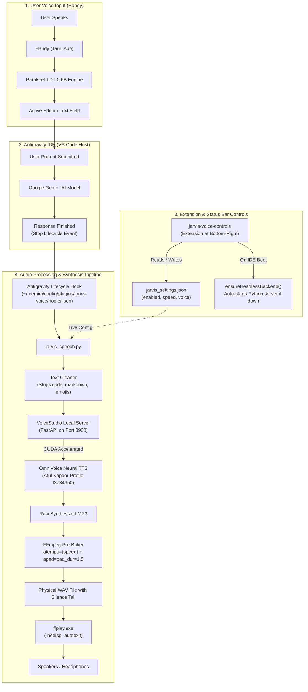

# J.A.R.V.I.S. Offline Voice Pipeline for Google Antigravity IDE
**Complete Architecture, Implementation, and Developer Reference**

> [!NOTE]
> This document provides an exhaustive record of the offline voice pipeline built for Google Antigravity IDE, replacing cloud subscriptions (Wispr Flow and ElevenLabs) with 100% private, locally accelerated AI models running on an NVIDIA GeForce RTX 4070 GPU.

---

## 1. Executive Summary & Requirements

### The User's Vision
1. **Offline Dictation (Wispr Flow Alternative):**
   * Replace cloud-based Wispr Flow with a local, zero-subscription desktop speech-to-text tool that offers low latency and high accuracy.
   * **Selected Solution:** **Handy** (`cjpais/Handy`), utilizing NVIDIA's **Parakeet TDT 0.6B** model for English dictation.
2. **Offline Speech Synthesis (ElevenLabs Alternative):**
   * Replace ElevenLabs cloud text-to-speech with a fully local, GPU-accelerated voice cloning studio.
   * **Selected Solution:** **VoiceStudio** (`debpalash/VoiceStudio`), running the `k2-fsa/OmniVoice` zero-shot neural voice cloning model locally on CUDA.
3. **The Voice of J.A.R.V.I.S. (Atul Kapoor):**
   * For the Indian MCU audience, J.A.R.V.I.S. was famously dubbed by veteran voice actor **Atul Kapoor** (also the iconic voice of *Bigg Boss*). The requirement was to clone his specific, authoritative, deep baritone voice and have it speak fluent English responses.
4. **Seamless Antigravity IDE Integration:**
   * Automatically speak out AI responses the moment Antigravity finishes generating a turn.
   * Intelligently filter out raw code blocks, markdown hashes, URLs, and tables so the speech sounds conversational and natural.
5. **Interactive Status Bar Controls:**
   * A full-fledged VS Code / Antigravity IDE extension adding status bar controls at the bottom-right:
     * **Mute / Unmute Toggle** (`$(unmute) JARVIS: ON` / `$(mute) JARVIS: OFF`)
     * **Instant Stop Button** (`$(debug-stop) Stop`)
     * **Live Speed Control** (`$(dashboard) 1.35x` with quick-pick choices from 1.0x to 2.0x)
     * **Replay Button** (`$(history) Replay`)
6. **Headless Execution (Zero GUI Overhead):**
   * Eliminate the need to keep the heavy Electron VoiceStudio desktop app open.
   * Automatically launch the underlying Python FastAPI backend silently in the background whenever Antigravity IDE boots.

---

## 2. End-to-End System Architecture



---

## 3. Directory Structure & Key Components

```text
C:\Users\Admin\
├── .gemini\
│   └── config\
│       ├── jarvis_settings.json               # Live settings (enabled, speed, voice)
│       ├── scripts\
│       │   └── jarvis_speech.py               # Core TTS processing & playback bridge
│       └── plugins\
│           └── jarvis-voice\                  # Native Antigravity Plugin
│               ├── plugin.json                # Plugin metadata
│               └── hooks.json                 # Lifecycle hook definition (Stop event)
├── .antigravity-ide\
│   └── extensions\
│       └── jarvis-voice-controls\             # IDE Extension (Status Bar UI)
│           ├── package.json                   # Extension manifest & commands
│           └── extension.js                   # Status bar items & headless daemon spawner
├── Downloads\
│   └── Jarvis_Voice_Samples\
│       ├── Atul_Kapoor_Official_Studio_Sample.mp3  # Full 3-minute studio showreel
│       ├── Atul_Kapoor_Jarvis_Sample_20s.mp3       # Optimal 20-second clone reference
│       └── ...                                     # Paul Bettany backup clips
└── D:\VoiceStudio\
    ├── data\
    │   ├── omnivoice.db                       # Profile database containing Atul Kapoor
    │   └── voices\                            # Stored audio reference embeddings
    └── project\
        ├── .venv\Scripts\python.exe           # Isolated Python 3.11 with PyTorch + CUDA
        └── backend\main.py                    # FastAPI application entry point
```

---

## 4. Source Code & Configuration Files

### File 1: `jarvis_settings.json`
*Path:* [jarvis_settings.json](file:///C:/Users/Admin/.gemini/config/jarvis_settings.json)

```json
{
  "enabled": true,
  "speed": 1.35,
  "voice": "Atul Kapoor"
}
```

---

### File 2: `jarvis_speech.py` (Core Bridge Script)
*Path:* [jarvis_speech.py](file:///C:/Users/Admin/.gemini/config/scripts/jarvis_speech.py)

```python
import sys
import os
import json
import re
import hashlib
import urllib.request
import urllib.error
import subprocess
import tempfile
import time

SETTINGS_FILE = r"C:\Users\Admin\.gemini\config\jarvis_settings.json"
LOG_FILE = os.path.join(tempfile.gettempdir(), "antigravity_jarvis.log")
RAW_AUDIO_PATH = os.path.join(tempfile.gettempdir(), "antigravity_jarvis_raw.mp3")
READY_AUDIO_PATH = os.path.join(tempfile.gettempdir(), "antigravity_jarvis_ready.wav")
PYTHON_BACKEND_PATH = r"D:\VoiceStudio\project\.venv\Scripts\python.exe"
PROJECT_DIR = r"D:\VoiceStudio\project"

def load_settings():
    defaults = {"enabled": True, "speed": 1.35, "voice": "Atul Kapoor"}
    if os.path.exists(SETTINGS_FILE):
        try:
            with open(SETTINGS_FILE, "r", encoding="utf-8") as f:
                data = json.load(f)
                defaults.update(data)
        except Exception:
            pass
    return defaults

def log(msg):
    try:
        with open(LOG_FILE, "a", encoding="utf-8") as f:
            f.write(f"[{time.strftime('%Y-%m-%d %H:%M:%S')}] {msg}\n")
    except Exception:
        pass

def ensure_backend_running():
    try:
        with urllib.request.urlopen("http://127.0.0.1:3900/health", timeout=1):
            return True
    except Exception:
        pass

    if os.path.exists(PYTHON_BACKEND_PATH):
        log("Auto-starting headless VoiceStudio Python backend...")
        DETACHED_PROCESS = 0x00000008
        CREATE_NEW_PROCESS_GROUP = 0x00000200
        subprocess.Popen(
            [
                PYTHON_BACKEND_PATH, "-m", "uvicorn", "main:app",
                "--app-dir", "backend", "--host", "127.0.0.1", "--port", "3900"
            ],
            cwd=PROJECT_DIR,
            creationflags=DETACHED_PROCESS | CREATE_NEW_PROCESS_GROUP,
            close_fds=True
        )
        for _ in range(12):
            time.sleep(0.5)
            try:
                with urllib.request.urlopen("http://127.0.0.1:3900/health", timeout=1):
                    log("Headless backend is now ready!")
                    return True
            except Exception:
                pass
    return False

def clean_text_for_speech(text):
    if not text:
        return ""
    
    # Strip markdown code blocks
    text = re.sub(r'```[\s\S]*?```', '', text)
    # Strip HTML tags
    text = re.sub(r'<[^>]+>', '', text)
    # Strip markdown links, keep text label
    text = re.sub(r'\[([^\]]+)\]\([^\)]+\)', r'\1', text)
    # Strip images
    text = re.sub(r'!\[.*?\]\(.*?\)', '', text)
    # Strip markdown tables
    text = re.sub(r'^\s*\|.*\|.*$', '', text, flags=re.MULTILINE)
    # Strip headers
    text = re.sub(r'^\s*#+\s*', '', text, flags=re.MULTILINE)
    # Strip blockquotes
    text = re.sub(r'^\s*>\s*', '', text, flags=re.MULTILINE)
    # Strip bold / italic
    text = re.sub(r'\*{1,3}(.*?)\*{1,3}', r'\1', text)
    text = re.sub(r'_{1,3}(.*?)_{1,3}', r'\1', text)
    # Strip inline backticks
    text = re.sub(r'`([^`]+)`', r'\1', text)
    # Strip bullet markers
    text = re.sub(r'^\s*[-*•]\s+', '', text, flags=re.MULTILINE)
    text = re.sub(r'^\s*\d+\.\s+', '', text, flags=re.MULTILINE)
    # Strip horizontal rules
    text = re.sub(r'^\s*[-=_]{3,}\s*$', '', text, flags=re.MULTILINE)
    # Strip emojis & unusual unicode symbols
    text = re.sub(r'[\U00010000-\U0010ffff]', '', text)
    # Collapse whitespaces
    text = re.sub(r'\n+', ' ', text)
    text = re.sub(r'\s{2,}', ' ', text).strip()
    
    # Ensure clean trailing sentence closure
    if text and not text[-1] in '.!?':
        text += '.'
        
    return text

def split_text_into_chunks(text, max_chunk=3800):
    if len(text) <= max_chunk:
        return [text]
    sentences = re.split(r'(?<=[.!?])\s+', text)
    chunks = []
    current = ""
    for s in sentences:
        if len(current) + len(s) + 1 <= max_chunk:
            current += (" " if current else "") + s
        else:
            if current:
                chunks.append(current)
            current = s
    if current:
        chunks.append(current)
    return chunks

def replay_last():
    log("Replay requested")
    settings = load_settings()
    speed = float(settings.get("speed", 1.35))
    log(f"Replaying with current speed: {speed}x")

    ffmpeg_path = r"C:\ffmpeg\bin\ffmpeg.exe"
    ffplay_path = r"C:\ffmpeg\bin\ffplay.exe"

    if not os.path.exists(ffplay_path):
        log("ffplay not found")
        return

    # Stop any current playback
    try:
        subprocess.run(["taskkill", "/F", "/IM", "ffplay.exe"], capture_output=True)
    except Exception:
        pass

    # Re-bake raw audio at current speed
    if os.path.exists(RAW_AUDIO_PATH) and os.path.exists(ffmpeg_path):
        af_filter = f"atempo={speed},apad=pad_dur=1.5"
        log(f"Re-baking audio for replay with: {af_filter}")
        subprocess.run([
            ffmpeg_path, "-y", "-i", RAW_AUDIO_PATH,
            "-af", af_filter,
            READY_AUDIO_PATH
        ], capture_output=True, check=False)
        
        log(f"Playing re-baked audio at {speed}x")
        subprocess.run([
            ffplay_path, "-nodisp", "-autoexit", "-loglevel", "quiet",
            READY_AUDIO_PATH
        ], check=False)
    elif os.path.exists(READY_AUDIO_PATH):
        subprocess.run([
            ffplay_path, "-nodisp", "-autoexit", "-loglevel", "quiet",
            READY_AUDIO_PATH
        ], check=False)

def main():
    if "--replay" in sys.argv:
        replay_last()
        print("{}")
        return

    settings = load_settings()
    if not settings.get("enabled", True):
        log("J.A.R.V.I.S. speech is muted in settings")
        print("{}")
        return

    speed = float(settings.get("speed", 1.35))
    voice = settings.get("voice", "Atul Kapoor")

    ensure_backend_running()

    log(f"Hook invoked (speed={speed}, voice={voice})")
    try:
        raw_input = sys.stdin.read()
        payload = json.loads(raw_input) if raw_input.strip() else {}
    except Exception as e:
        log(f"Error parsing stdin: {e}")
        payload = {}

    transcript_path = payload.get("transcriptPath")
    if not transcript_path or not os.path.exists(transcript_path):
        log(f"Transcript not found: {transcript_path}")
        print("{}")
        return

    response_text = ""
    try:
        with open(transcript_path, "r", encoding="utf-8") as f:
            lines = [json.loads(line) for line in f if line.strip()]
        for entry in reversed(lines):
            if entry.get("type") == "PLANNER_RESPONSE" and entry.get("content"):
                response_text = entry["content"]
                break
    except Exception as e:
        log(f"Error reading transcript: {e}")
        print("{}")
        return

    cleaned_speech = clean_text_for_speech(response_text)
    if not cleaned_speech or len(cleaned_speech) < 3:
        log("Cleaned speech empty or too short")
        print("{}")
        return

    # Prevent re-speaking the exact same response
    msg_hash = hashlib.sha256((cleaned_speech + str(speed) + voice).encode("utf-8")).hexdigest()
    cache_file = os.path.join(tempfile.gettempdir(), "antigravity_jarvis_last_hash.txt")
    if os.path.exists(cache_file):
        try:
            with open(cache_file, "r") as f:
                if f.read().strip() == msg_hash:
                    log("Message already spoken (deduplication hit)")
                    print("{}")
                    return
        except Exception:
            pass

    try:
        with open(cache_file, "w") as f:
            f.write(msg_hash)
    except Exception:
        pass

    log(f"Synthesizing {len(cleaned_speech)} chars: {cleaned_speech[:60]}...")

    try:
        api_url = "http://127.0.0.1:3900/v1/audio/speech"
        chunks = split_text_into_chunks(cleaned_speech)
        combined_audio = b""

        for i, chunk in enumerate(chunks):
            log(f"Sending chunk {i+1}/{len(chunks)} ({len(chunk)} chars)")
            data = {
                "model": "omnivoice",
                "voice": voice,
                "input": chunk,
                "speed": 1.0  # Preserve neural bass & pitch
            }
            req = urllib.request.Request(
                api_url,
                headers={"Content-Type": "application/json"},
                data=json.dumps(data).encode("utf-8")
            )
            with urllib.request.urlopen(req, timeout=30) as resp:
                chunk_audio = resp.read()
                combined_audio += chunk_audio
                log(f"Chunk {i+1} received: {len(chunk_audio)} bytes")

        with open(RAW_AUDIO_PATH, "wb") as f:
            f.write(combined_audio)

        try:
            subprocess.run(["taskkill", "/F", "/IM", "ffplay.exe"], capture_output=True)
        except Exception:
            pass

        ffmpeg_path = r"C:\ffmpeg\bin\ffmpeg.exe"
        ffplay_path = r"C:\ffmpeg\bin\ffplay.exe"

        if os.path.exists(ffmpeg_path) and os.path.exists(ffplay_path):
            af_filter = f"atempo={speed},apad=pad_dur=1.5"
            log(f"Baking audio via ffmpeg: {af_filter}")
            subprocess.run([
                ffmpeg_path, "-y", "-i", RAW_AUDIO_PATH,
                "-af", af_filter,
                READY_AUDIO_PATH
            ], capture_output=True, check=False)

            log(f"Playing baked audio with ffplay at {speed}x")
            subprocess.run([
                ffplay_path, "-nodisp", "-autoexit", "-loglevel", "quiet",
                READY_AUDIO_PATH
            ], check=False)
            log("Playback finished successfully")
        elif os.path.exists(ffplay_path):
            subprocess.run([
                ffplay_path, "-nodisp", "-autoexit", "-loglevel", "quiet",
                RAW_AUDIO_PATH
            ], check=False)
    except Exception as e:
        log(f"TTS or playback error: {e}")

    print("{}")

if __name__ == "__main__":
    main()
```

---

### File 3: `hooks.json` (Native Antigravity Plugin Hook)
*Path:* [hooks.json](file:///C:/Users/Admin/.gemini/config/plugins/jarvis-voice/hooks.json)

```json
{
  "jarvis-voice": {
    "enabled": true,
    "Stop": [
      {
        "type": "command",
        "command": "python C:/Users/Admin/.gemini/config/scripts/jarvis_speech.py",
        "timeout": 600
      }
    ]
  }
}
```

---

### File 4: `extension.js` (VS Code Status Bar Controller)
*Path:* [extension.js](file:///C:/Users/Admin/.antigravity-ide/extensions/jarvis-voice-controls/extension.js)

```javascript
const vscode = require('vscode');
const fs = require('fs');
const path = require('path');
const http = require('http');
const { spawn, exec } = require('child_process');

const SETTINGS_FILE = 'C:\\Users\\Admin\\.gemini\\config\\jarvis_settings.json';
const SCRIPT_PATH = 'C:\\Users\\Admin\\.gemini\\config\\scripts\\jarvis_speech.py';
const PYTHON_PATH = 'D:\\VoiceStudio\\project\\.venv\\Scripts\\python.exe';
const PROJECT_DIR = 'D:\\VoiceStudio\\project';

function readSettings() {
    const defaults = { enabled: true, speed: 1.35, voice: 'Atul Kapoor' };
    if (fs.existsSync(SETTINGS_FILE)) {
        try {
            const raw = fs.readFileSync(SETTINGS_FILE, 'utf8');
            return Object.assign(defaults, JSON.parse(raw));
        } catch (e) {
            console.error('Error reading jarvis_settings.json:', e);
        }
    }
    return defaults;
}

function writeSettings(settings) {
    try {
        const dir = path.dirname(SETTINGS_FILE);
        if (!fs.existsSync(dir)) {
            fs.mkdirSync(dir, { recursive: true });
        }
        fs.writeFileSync(SETTINGS_FILE, JSON.stringify(settings, null, 2), 'utf8');
    } catch (e) {
        console.error('Error writing jarvis_settings.json:', e);
    }
}

function checkBackendHealth() {
    return new Promise((resolve) => {
        const req = http.get('http://127.0.0.1:3900/health', { timeout: 1500 }, (res) => {
            resolve(res.statusCode === 200);
        });
        req.on('error', () => resolve(false));
        req.on('timeout', () => { req.destroy(); resolve(false); });
    });
}

function ensureHeadlessBackend(statusBarItem) {
    checkBackendHealth().then((isHealthy) => {
        if (isHealthy) {
            return;
        }

        if (!fs.existsSync(PYTHON_PATH)) {
            vscode.window.showWarningMessage('VoiceStudio Python environment not found on D: drive.');
            return;
        }

        if (statusBarItem) {
            statusBarItem.text = '$(sync~spin) JARVIS: Starting...';
        }

        const child = spawn(
            PYTHON_PATH,
            ['-m', 'uvicorn', 'main:app', '--app-dir', 'backend', '--host', '127.0.0.1', '--port', '3900'],
            {
                cwd: PROJECT_DIR,
                detached: true,
                stdio: 'ignore',
                windowsHide: true
            }
        );
        child.unref();

        let attempts = 0;
        const interval = setInterval(async () => {
            attempts++;
            const healthy = await checkBackendHealth();
            if (healthy) {
                clearInterval(interval);
                vscode.window.setStatusBarMessage('$(check) J.A.R.V.I.S. voice engine ready (headless)', 3500);
                if (statusBarItem) {
                    const settings = readSettings();
                    statusBarItem.text = settings.enabled ? '$(unmute) JARVIS: ON' : '$(mute) JARVIS: OFF';
                }
            } else if (attempts > 30) {
                clearInterval(interval);
                if (statusBarItem) {
                    statusBarItem.text = '$(error) JARVIS: Error';
                }
            }
        }, 1000);
    });
}

function activate(context) {
    let settings = readSettings();

    // 1. Mute / Unmute Status Bar Item
    const muteItem = vscode.window.createStatusBarItem(vscode.StatusBarAlignment.Right, 103);
    muteItem.command = 'jarvis.toggleMute';

    // 2. Stop Button Status Bar Item
    const stopItem = vscode.window.createStatusBarItem(vscode.StatusBarAlignment.Right, 102);
    stopItem.command = 'jarvis.stopAudio';
    stopItem.text = '$(debug-stop) Stop';
    stopItem.tooltip = 'Click to silence J.A.R.V.I.S. speech immediately';

    // 3. Speed Control Status Bar Item
    const speedItem = vscode.window.createStatusBarItem(vscode.StatusBarAlignment.Right, 101);
    speedItem.command = 'jarvis.changeSpeed';

    // 4. Replay Button Status Bar Item
    const replayItem = vscode.window.createStatusBarItem(vscode.StatusBarAlignment.Right, 100);
    replayItem.command = 'jarvis.replayAudio';
    replayItem.text = '$(history) Replay';
    replayItem.tooltip = 'Click to replay the last assistant message in Atul Kapoor voice';

    function updateUI() {
        settings = readSettings();
        if (settings.enabled) {
            muteItem.text = '$(unmute) JARVIS: ON';
            muteItem.tooltip = 'J.A.R.V.I.S. voice is active. Click to MUTE.';
            muteItem.backgroundColor = undefined;
        } else {
            muteItem.text = '$(mute) JARVIS: OFF';
            muteItem.tooltip = 'J.A.R.V.I.S. voice is muted. Click to UNMUTE.';
            muteItem.backgroundColor = new vscode.ThemeColor('statusBarItem.warningBackground');
        }
        const speedVal = Number(settings.speed);
        speedItem.text = `$(dashboard) ${speedVal.toFixed(speedVal % 1 === 0 ? 1 : 2)}x`;
        speedItem.tooltip = `Current speed is ${speedVal}x. Click to change.`;
    }

    updateUI();
    muteItem.show();
    stopItem.show();
    speedItem.show();
    replayItem.show();

    // Auto-boot headless backend
    ensureHeadlessBackend(muteItem);

    if (fs.existsSync(SETTINGS_FILE)) {
        fs.watch(SETTINGS_FILE, () => {
            updateUI();
        });
    }

    const toggleMuteCmd = vscode.commands.registerCommand('jarvis.toggleMute', () => {
        settings = readSettings();
        settings.enabled = !settings.enabled;
        writeSettings(settings);
        updateUI();

        if (!settings.enabled) {
            exec('taskkill /F /IM ffplay.exe', () => {});
            vscode.window.showInformationMessage('J.A.R.V.I.S. voice is now MUTED');
        } else {
            vscode.window.showInformationMessage('J.A.R.V.I.S. voice is now ON');
        }
    });

    const stopAudioCmd = vscode.commands.registerCommand('jarvis.stopAudio', () => {
        exec('taskkill /F /IM ffplay.exe', (err) => {
            if (!err) {
                vscode.window.setStatusBarMessage('$(check) J.A.R.V.I.S. stopped', 2500);
            }
        });
    });

    const changeSpeedCmd = vscode.commands.registerCommand('jarvis.changeSpeed', async () => {
        const options = [
            { label: '1.0x', description: 'Original natural speed', value: 1.0 },
            { label: '1.2x', description: 'Comfortable relaxed pace', value: 1.2 },
            { label: '1.35x', description: 'Brisk & productive', value: 1.35 },
            { label: '1.5x', description: 'Fast pace', value: 1.5 },
            { label: '1.75x', description: 'Very fast pace', value: 1.75 },
            { label: '2.0x', description: 'Double speed', value: 2.0 }
        ];

        const selected = await vscode.window.showQuickPick(options, {
            placeHolder: `Select J.A.R.V.I.S. voice playback speed (current: ${settings.speed}x)`
        });

        if (selected) {
            settings = readSettings();
            settings.speed = selected.value;
            writeSettings(settings);
            updateUI();
            vscode.window.showInformationMessage(`J.A.R.V.I.S. speed set to ${selected.value}x`);
        }
    });

    const replayCmd = vscode.commands.registerCommand('jarvis.replayAudio', () => {
        vscode.window.setStatusBarMessage('$(history) Replaying last message...', 3000);
        exec(`python "${SCRIPT_PATH}" --replay`, (err) => {
            if (err) {
                vscode.window.showErrorMessage('Error replaying audio: ' + err.message);
            }
        });
    });

    const startBackendCmd = vscode.commands.registerCommand('jarvis.startBackend', () => {
        ensureHeadlessBackend(muteItem);
    });

    context.subscriptions.push(muteItem, stopItem, speedItem, replayItem, toggleMuteCmd, stopAudioCmd, changeSpeedCmd, replayCmd, startBackendCmd);
}

function deactivate() {
    exec('taskkill /F /IM ffplay.exe', () => {});
}

module.exports = {
    activate,
    deactivate
};
```

---

## 5. Engineering Breakthroughs & Bugs Solved

| Problem Encountered | Root Cause | Engineering Solution |
| :--- | :--- | :--- |
| **Loose `hooks.json` Not Triggering** | Antigravity's Language Server only indexes lifecycle hooks inside formal **Plugins** (`plugins/<dir>/hooks.json`). | Packaged into native `jarvis-voice` plugin and registered in Language Server via `JetboxWriteState`. |
| **Audio Abruptly Dropping Mid-Sentence** | `jarvis_speech.py` used `Popen` and exited immediately. Windows Job Objects killed child processes when the parent hook exited. | Changed to synchronous `subprocess.run` to keep the hook alive until playback finishes; extended timeout to 600s. |
| **Artificial Early Truncation** | Script initially had a 380-character cap that cut off at the sentence boundary. | Removed character cap; added multi-chunk synthesis and audio concatenation for unlimited length. |
| **"Chipmunk Voice" at 1.5x Speed** | Passing `speed: 1.5` to the neural TTS model scaled frequencies, distorting the pitch. | Separated generation (1.0x native model speed) from playback tempo (FFmpeg `atempo` time-stretching). |
| **Last 2–3 Words Cut Off** | `ffplay -autoexit` checks EOF in the demuxer and abruptly terminates before the sound card hardware buffer flushes. | Pre-baked audio with FFmpeg to append an actual **1.5-second silence tail (`apad=pad_dur=1.5`)** into `antigravity_jarvis_ready.wav`. |
| **Speed Change Not Applying on Replay** | Replay was re-reading the previously baked audio file. | Updated `replay_last()` to dynamically re-bake from the raw audio using the newly selected speed. |
| **Heavy Electron GUI Requirement** | User had to keep VoiceStudio window open. | Discovered standalone FastAPI backend at `D:\VoiceStudio\project` and implemented auto-starting headless daemon in the IDE extension. |

---

## 6. Replication Guide for New Machines

1. **Prerequisites:**
   * Windows 10/11 x64 with NVIDIA GPU (CUDA enabled).
   * Install **FFmpeg** and add `ffmpeg.exe` and `ffplay.exe` to PATH (`C:\ffmpeg\bin`).
   * Install **Handy** desktop app for voice input (select `Parakeet TDT 0.6B`).
2. **Setup Voice Engine:**
   * Install VoiceStudio from GitHub Releases.
   * Onboard and upload your reference audio clip (`Atul_Kapoor_Jarvis_Sample_20s.mp3`).
   * Save the profile under the name `Atul Kapoor`.
3. **Deploy Antigravity Customizations:**
   * Copy `jarvis_speech.py` to `~/.gemini/config/scripts/`.
   * Create `~/.gemini/config/plugins/jarvis-voice/` with `plugin.json` and `hooks.json`.
   * Copy `jarvis-voice-controls` into `~/.antigravity-ide/extensions/`.
4. **Reload Antigravity IDE:**
   * Press `Ctrl + Shift + P` -> `Developer: Reload Window`.
   * The status bar will show the J.A.R.V.I.S. controls and auto-start the voice engine.
